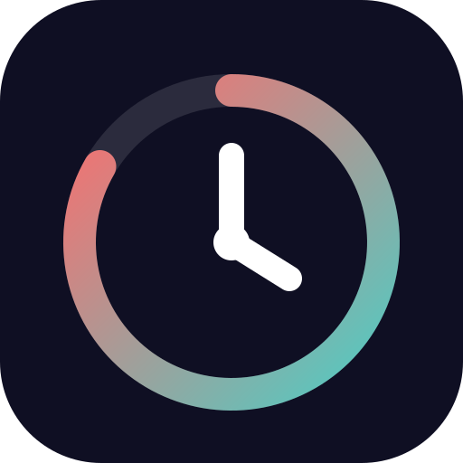
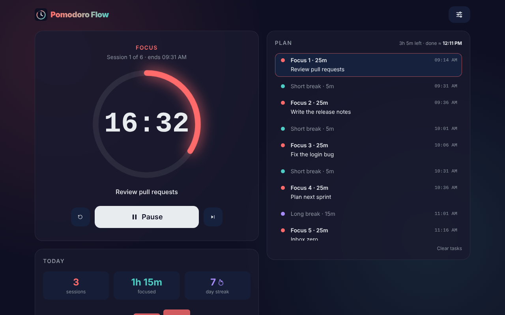
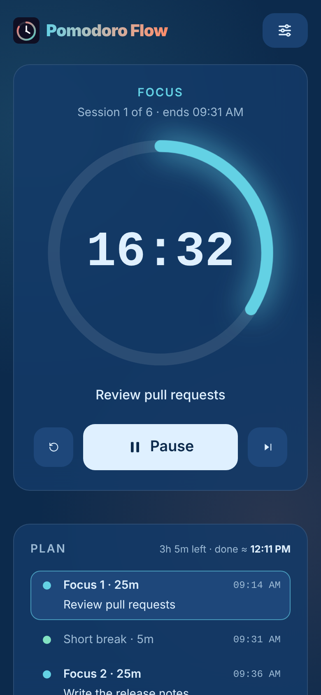
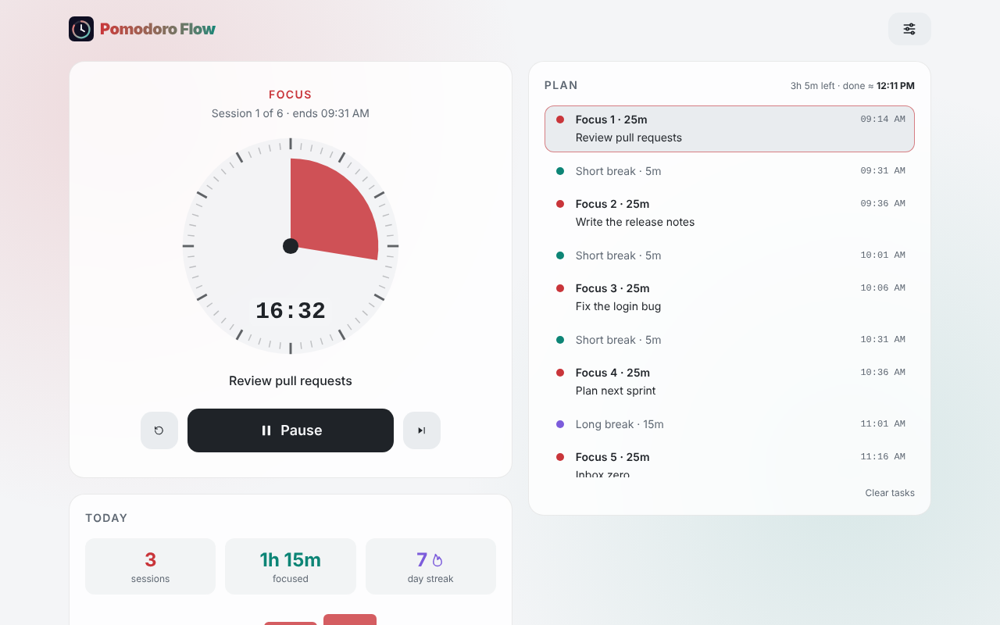
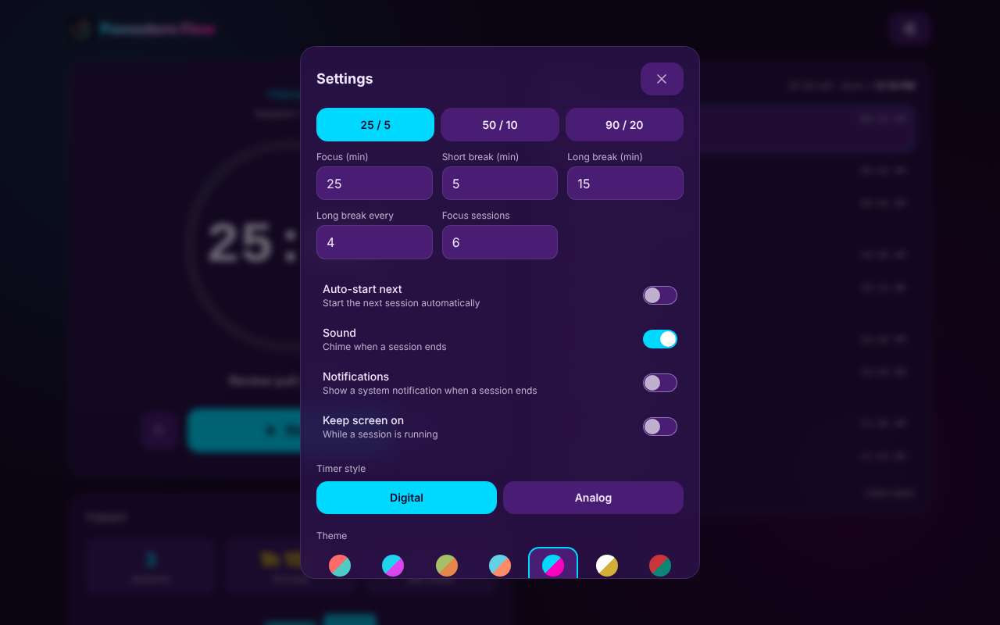
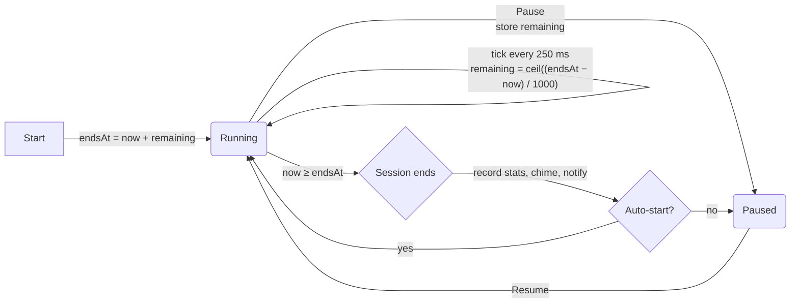

<div align="center">



# Pomodoro Flow

**A fast, offline-ready Pomodoro timer with a daily session plan and stats.**

[](https://github.com/hzd96/pomodoro-flow/actions/workflows/ci.yml)


[Features](#-features) · [Quick start](#-quick-start) · [Deploy](#-deploy-to-cloudflare-pages) · [Roadmap](#-roadmap)

</div>

<p align="center">
  
</p>

Pomodoro Flow is a focus timer built for **one person, every day**. Open it, press <kbd>Space</kbd>, and get to work. Your whole day's plan is laid out with live start times, each focus session can carry a task, and a small stats card keeps your streak honest.

It is a **static, client-only app**: no backend, no account, no analytics, no tracking. Everything is stored in your browser, it keeps working offline once it has been cached, and it can be hosted for free on Cloudflare Pages.

> [!NOTE]
> The app is not deployed yet, so there is no live demo. Run it locally in under a minute with the [Quick start](#-quick-start).

---

## Table of contents

- [Features](#-features)
- [Screenshots](#-screenshots)
- [Quick start](#-quick-start)
- [Deploy to Cloudflare Pages](#-deploy-to-cloudflare-pages)
- [Usage](#-usage)
- [How it works](#-how-it-works)
- [Project structure](#-project-structure)
- [Tech stack](#-tech-stack)
- [Privacy](#-privacy)
- [Browser support](#-browser-support)
- [Known limitations](#-known-limitations)
- [Roadmap](#-roadmap)
- [Contributing](#-contributing)
- [History and acknowledgments](#-history-and-acknowledgments)
- [License](#-license)

---

## ✨ Features

### ⏰ Timer

- **Two timer styles:** a **digital** progress ring with a soft pulsing glow, or an **analog** kitchen-timer dial with a wedge showing the minutes left on a 60-minute face.
- **Drift-free timing:** the countdown is derived from an absolute end timestamp, so throttled background tabs still show the correct time.
- **Survives reloads:** a running session keeps counting down across a page reload or a browser restart.
- **Color-coded sessions:** Focus, Short break and Long break each have their own color.
- **Live tab title:** the browser tab shows the countdown, e.g. `16:32 · Focus`.

### 📅 Plan

- **A full day's plan** generated from your settings (default: 8 × 25 min focus, 5 min short breaks, a 15 min long break every 4 sessions).
- **Live projected times:** each upcoming session shows its start time, and the header shows `<time> left · done ≈ <finish time>`.
- **Jump to any session:** click a row's dot to make it current, backwards or forwards.
- **Per-session tasks:** type what you will work on next to each focus session; the current task appears under the timer. Right-to-left text displays correctly.
- **Auto-scroll:** the current session is kept in view inside the plan, without scrolling the page.
- **Multi-tab safe:** open tabs and the installed app stay in sync, and a finished session is counted once.

### 📊 Stats

- **Today:** completed sessions, minutes focused and your **day streak**.
- **Last 7 days:** a compact bar chart of focused minutes per day.

### 🔔 Alerts and comfort

- **Chime** generated with the Web Audio API: falling notes after focus, rising notes after a break.
- **System notifications** when a session ends (optional).
- **Keep screen on** with the Screen Wake Lock API while a session runs (optional).
- **Auto-start** the next session when one ends (optional).

### 🎨 Look and feel

- **Seven themes:** Classic, Cyberpunk, Forest, Ocean, Synthwave, Glamour and Light.
- **No theme flash:** the saved theme is applied before the first paint.
- **Responsive layout:** two columns on large screens, a single column on phones, with iOS safe-area support.
- **Keyboard first:** <kbd>Space</kbd> · <kbd>N</kbd> · <kbd>R</kbd> · <kbd>S</kbd>, on any keyboard layout.
- **Respects reduced motion:** the glow animation and CSS transitions are turned off.

### 📦 PWA and hosting

- **Installable** through the browser's own "Install app" or "Add to Home Screen".
- **Offline from the first visit:** a small hand-written service worker precaches every built file.
- **Tiny:** about 78 kB of JavaScript and 6 kB of CSS, gzipped. React is the only runtime dependency.
- **Free static hosting** on Cloudflare Pages, with caching headers included.

---

## 📸 Screenshots

<table>
  <tr>
    <td align="center">
      
    </td>
    <td align="center">
      
    </td>
    <td align="center">
      
    </td>
  </tr>
  <tr>
    <td align="center"><sub><b>Mobile</b> · Ocean theme</sub></td>
    <td align="center"><sub><b>Analog dial</b> · Light theme</sub></td>
    <td align="center"><sub><b>Settings</b> · Synthwave theme</sub></td>
  </tr>
</table>

<sub>The screenshots use a 6-session plan with sample tasks and stats.</sub>

---

## 🚀 Quick start

**Prerequisites:** [Node.js](https://nodejs.org/) 22 (pinned in [`.nvmrc`](.nvmrc) and used by CI; Vite 7 needs at least 20.19) and npm.

```bash
git clone https://github.com/hzd96/pomodoro-flow.git
cd pomodoro-flow
npm install
npm run dev        # http://localhost:3000
```

| Script | Command | What it does |
| --- | --- | --- |
| `npm run dev` | `vite` | Dev server with hot reload on port **3000** |
| `npm run build` | `tsc --noEmit && vite build` | Type-check, then build to `dist/` |
| `npm run preview` | `vite preview` | Serve the production build locally (port **4173**) |
| `npm run typecheck` | `tsc --noEmit` | Type-check only |
| `npm test` | `vitest run` | Run the unit tests once |
| `npm run test:watch` | `vitest` | Run the unit tests in watch mode |
| `npm run deploy` | `npm run build && npx wrangler pages deploy dist` | Build and upload to Cloudflare Pages |

> [!TIP]
> The service worker is registered only in production builds. To test offline behavior or installation, use `npm run build && npm run preview`, not `npm run dev`.

---

## 📤 Deploy to Cloudflare Pages

The build output is a plain static folder (`dist/`), so any static host works. Cloudflare Pages is free and is what this repo is set up for. Pick **one** of the three options below.

### A. Git integration (recommended: auto-deploy on every push)

1. In the Cloudflare dashboard, go to **Workers & Pages → Create → Pages → Connect to Git** and choose this repository.
2. Use these build settings:

   | Setting | Value |
   | --- | --- |
   | Framework preset | `None` (or `React (Vite)`) |
   | Build command | `npm run build` |
   | Build output directory | `dist` |
   | Production branch | `main` |
   | Node version | `22` (set `NODE_VERSION=22` if needed) |

3. Click **Save and Deploy**. From now on, every push to `main` deploys automatically, and pull requests get preview URLs.

### B. Direct upload (no Git, no CLI)

1. Run `npm run build`, then zip the **contents** of `dist/`.
2. Go to **Workers & Pages → Create → Pages → Upload assets**.
3. Drop the zip file and click **Deploy**.

### C. Wrangler CLI

```bash
npx wrangler login   # once
npm run deploy       # builds, then runs: npx wrangler pages deploy dist
```

[`wrangler.toml`](wrangler.toml) already sets the project name (`pomodoro-flow`) and the output directory (`dist`). Wrangler is not a dependency; `npx` downloads it on demand.

### Caching headers

[`public/_headers`](public/_headers) is copied into `dist/` and applied by Cloudflare Pages:

| Path | Header |
| --- | --- |
| `/assets/*` | `Cache-Control: public, max-age=31536000, immutable` (hashed bundles) |
| `/sw.js` | `Cache-Control: no-cache` (so service-worker updates are picked up) |
| `/*` | `X-Content-Type-Options: nosniff`, `Referrer-Policy: strict-origin-when-cross-origin` |

### Optional extras

- **Keep the site to yourself (free):** in **Zero Trust → Access → Applications**, add a self-hosted application for your `*.pages.dev` domain (and any custom domain) and allow only your email. All data is local anyway, so this only hides the page. See roadmap item [C3](#deployment) for PWA caveats.
- **Custom domain:** in your Pages project, open **Custom domains** and add one. The free `*.pages.dev` address works fine without it.

---

## 🧭 Usage

### Daily workflow

1. Open the app. Today's plan is already built from your settings.
2. Optionally type a task next to each focus session.
3. Press **Start** (or <kbd>Space</kbd>). The plan's times update live as you go.
4. When a session ends you hear a chime (and get a notification, if enabled). The next session waits for you, or starts on its own with **Auto-start next**.
5. When the plan is complete, press **New plan** (or <kbd>Space</kbd>) to start again.

### Controls

| Control | What it does |
| --- | --- |
| **Start / Pause / Resume** | Starts or pauses the current session. Reads **New plan** when the plan is complete. |
| **Skip** | Moves to the next session, **paused**, even when auto-start is on. |
| **Reset** | Rebuilds the plan from your settings and returns to Focus 1, paused. Asks first once a plan is under way; focus time so far is kept in your stats. |
| **Row dot** in the plan | Jumps to that session, paused, at full length. Focus time so far is kept in your stats. |
| **Clear tasks** | Removes all tasks at once. No confirmation. |

### Keyboard shortcuts

| Key | Action |
| --- | --- |
| <kbd>Space</kbd> | Start / pause (starts a new plan when the current one is complete) |
| <kbd>N</kbd> | Skip to the next session |
| <kbd>R</kbd> | Reset the plan (asks first once a plan is under way) |
| <kbd>S</kbd> | Open Settings |

Shortcuts are ignored while typing in a field, while Settings is open, and when <kbd>Ctrl</kbd>, <kbd>Alt</kbd> or <kbd>Meta</kbd> is held. They match physical key positions, so they also work on non-Latin layouts such as Persian. Holding a key doesn't repeat it, and <kbd>Space</kbd> presses a button you reached with <kbd>Tab</kbd> instead of toggling the timer.

### Settings

| Setting | Default | Range | Notes |
| --- | --- | --- | --- |
| Focus (min) | 25 | 1–180 | Length of each focus session, in minutes |
| Short break (min) | 5 | 1–60 | Length of each short break, in minutes |
| Long break (min) | 15 | 1–90 | Length of each long break, in minutes |
| Long break every | 4 | 2–10 | Focus sessions between long breaks |
| Focus sessions | 8 | 1–20 | Focus sessions per plan |
| Auto-start next | Off | | Starts the next session when one ends; it starts from the previous end time, so the plan doesn't drift |
| Sound | On | | Chime when a session ends |
| Notifications | Off | | Asks for browser permission when turned on |
| Keep screen on | Off | | Holds a screen wake lock while a session runs |
| Timer style | Digital | Digital / Analog | |
| Theme | Classic | 7 themes | |

Number fields save when you leave the field or press <kbd>Enter</kbd>; out-of-range values are flagged and not saved.

**Presets:** `25 / 5` (long 15), `50 / 10` (long 30) and `90 / 20` (long 30). They do not change *Long break every* or *Focus sessions*.

**When changes apply:** before you start a plan, any change rebuilds it immediately. Once a plan is under way, new durations are saved for the **next** plan, and Settings offers a **Restart plan now** button. Sound, notifications, auto-start, keep-awake, timer style and theme always apply immediately.

### Themes

| Theme | Scheme |
| --- | --- |
| Classic (default) | Dark |
| Cyberpunk | Dark |
| Forest | Dark |
| Ocean | Dark |
| Synthwave | Dark |
| Glamour | Dark |
| Light | Light |

### Timer styles

- **Digital:** an SVG progress ring that fills as time passes, with a pulsing glow while running.
- **Analog:** a kitchen-timer dial with 60 tick marks. The colored wedge shows the minutes left on a 60-minute face; past an hour it shows the time left in the current hour, and the countdown shows the hours.

### How stats are counted

| Event | Sessions | Focused minutes |
| --- | --- | --- |
| A focus session runs out | +1 | + its full planned length |
| You leave a focus session after ≥ 1 minute (skip, jump or reset) | — | + the minutes actually elapsed |
| Breaks, pause | — | — |

- Stats are kept per **local calendar day**. A completed session counts on the day it ended, even if the app only notices later (e.g. after the laptop slept); partial focus counts on the day you left the session.
- A session that finishes while two tabs are open is counted **once**.
- The **streak** counts consecutive days with at least one completed session. Today does not break the streak until it is over.
- There is currently no way to reset, export or import stats (see [X1](#features-and-ux)).

### Install as an app

- **Desktop (Chrome/Edge):** click the install icon in the address bar.
- **Android (Chrome):** menu → *Install app*.
- **iOS/iPadOS (Safari):** Share → *Add to Home Screen*.

Installing needs the production build served over HTTPS (or `localhost`).

---

## 🔧 How it works

### Timing model



- While running, the app stores only an **absolute end time** (`endsAt`, epoch milliseconds). The remaining time is recomputed on every render as `max(0, ceil((endsAt − now) / 1000))`, so late or throttled ticks never cause drift.
- While paused, it stores the **remaining seconds** instead.
- The clock ticks every **250 ms** while running and every **15 s** while paused, which keeps the plan's projected times current. Ticks come from a small Web Worker ([`ticker.worker.ts`](src/lib/ticker.worker.ts)), whose timers aren't throttled like a hidden tab's, so alerts fire on time in background tabs.
- With **Auto-start**, the next session starts from the previous `endsAt` when the end is noticed within 2 minutes, so the plan doesn't drift; after a longer gap (e.g. sleep) it starts from now.
- Projected times are chained from *now*: the current session ends at `endsAt` (or now + remaining when paused), and each later session starts when the previous one ends.

### Persistence

Everything lives in `localStorage`:

| Key | Contents |
| --- | --- |
| `pomodoro-flow:state` | `{ version: 1, settings, schedule, timer, tasks }`, where `timer` is `{ sessionIndex, endsAt, remainingSeconds }` |
| `pomodoro-flow:stats` | `{ version: 1, days: { "YYYY-MM-DD": { sessions, focusMinutes } }, lastCredited }` |

Saved data is validated on load: settings are clamped to the ranges above (new settings get their defaults), and a schedule or timer with an unexpected shape is replaced. Other tabs pick up changes through the `storage` event, and `lastCredited` keeps two tabs from counting the same session twice. Every storage access is wrapped in `try/catch`: if storage is full or blocked, the app still works for the current visit. If a session ended while the app was closed, reopening it counts that session as completed and advances the plan by one step.

### Offline service worker

[`public/sw.js`](public/sw.js) is registered on page load in production builds only.

| Request | Strategy |
| --- | --- |
| Install | Precache `/`, the manifest, two icons and every built `/assets/*` file into a cache named after the build (`pomodoro-flow-<build id>`) |
| Page navigations | Network first; fall back to the cached `/` when offline |
| Other same-origin GETs (JS, CSS, icons) | Stale-while-revalidate |
| Cross-origin or non-GET | Not handled |

The `sw-precache` plugin in [`vite.config.ts`](vite.config.ts) writes the build id and the list of built files into `dist/sw.js`, so offline launch works from the **first** visit. On activate, the worker deletes every other cache (including old builds' assets) and takes control of open pages. Only successful same-origin pages are stored as the app shell, never an error or a login redirect.

### Notifications, sound and wake lock

- **Notifications are local**, not Web Push. They are shown through the service worker when one is registered (otherwise with `new Notification()`) and replace one another via a shared tag. Clicking one shown through the service worker focuses the app (or opens it if no window is open).
- **The chime** is three short sine notes from the Web Audio API. Browsers require a user gesture first, so audio is unlocked on your first click or key press, including after a reload.
- **The wake lock** is requested while a session runs and re-requested when the tab becomes visible again, since browsers release it when a tab is hidden.

---

## 📁 Project structure

```text
pomodoro-flow/
├── index.html                  # HTML shell: PWA/iOS meta tags, pre-paint theme script, #root
├── public/
│   ├── sw.js                   # Offline service worker + notification click handler
│   ├── manifest.webmanifest    # Web app manifest
│   ├── _headers                # Cloudflare Pages response headers
│   └── icons/                  # SVG, 192 px, 512 px and 180 px Apple touch icon
├── src/
│   ├── main.tsx                # React root (StrictMode) + service-worker registration
│   ├── App.tsx                 # Page layout + global keyboard shortcuts
│   ├── usePomodoro.ts          # Core hook: state, ticking, actions, persistence, side effects
│   ├── types.ts                # Shared types (Session, Settings, TimerState, Task, ...)
│   ├── index.css               # Tailwind v4, theme tokens, 7 palettes, components, motion
│   ├── vite-env.d.ts           # Vite client types
│   ├── components/
│   │   ├── Timer.tsx           # Timer card: digital ring / analog dial, label, controls
│   │   ├── Schedule.tsx        # "Plan" card: sessions, projected times, jump, tasks
│   │   ├── Stats.tsx           # "Today" card: sessions, minutes, streak, 7-day chart
│   │   ├── SettingsDialog.tsx  # Settings modal: presets, durations, toggles, style, theme
│   │   └── Icon.tsx            # 8 inline SVG icons
│   └── lib/
│       ├── schedule.ts         # buildSchedule, session labels, settings bounds
│       ├── format.ts           # Countdown, time-of-day and duration formatting
│       ├── stats.ts            # Per-day stats, streak, last 7 days
│       ├── storage.ts          # Defaults, validated localStorage state and stats
│       ├── alerts.ts           # Web Audio chime + notifications
│       ├── ticker.ts           # Clock ticks from a worker (falls back to setInterval)
│       ├── ticker.worker.ts    # The worker itself
│       └── *.test.ts           # Vitest unit tests
├── docs/screenshots/           # Images used in this README
├── .github/workflows/ci.yml    # CI: install, unit tests, type check + build
├── .nvmrc                      # Node version for local, CI and Cloudflare builds
├── vite.config.ts              # Vite + React + Tailwind plugins, sw-precache plugin, dev port 3000
├── tsconfig.json               # Strict TypeScript settings
├── wrangler.toml               # Cloudflare Pages config for `npm run deploy`
├── package.json
├── package-lock.json           # Locked dependency versions (used by npm ci in CI)
└── .gitignore
```

---

## 🧰 Tech stack

| Area | Choice |
| --- | --- |
| UI | [React 19](https://react.dev/) (StrictMode, plain hooks, no state library or router) |
| Language | [TypeScript 5.9](https://www.typescriptlang.org/) (strict) |
| Build | [Vite 7](https://vite.dev/) with `@vitejs/plugin-react` |
| Styling | [Tailwind CSS v4](https://tailwindcss.com/) via `@tailwindcss/vite`, themed with CSS variables |
| Icons | Hand-written inline SVG |
| Offline | Hand-written service worker and web app manifest |
| Browser APIs | Web Audio, Notifications, Screen Wake Lock, `localStorage`, `<dialog>` |
| Hosting | [Cloudflare Pages](https://pages.cloudflare.com/) |
| Testing | [Vitest 3](https://vitest.dev/) unit tests for the pure logic |
| CI | GitHub Actions (Node from `.nvmrc`, `npm ci`, `npm test`, `npm run build`) |

---

## 🔒 Privacy

- **No accounts, no cookies, no analytics, no external fonts or CDNs.**
- Apart from loading its own static files, the app makes **no network requests**.
- Settings, the plan, tasks and stats are stored **only in your browser's `localStorage`**, on that device. Nothing is sent anywhere.
- Clearing the site's data in your browser deletes everything.

---

## 🌐 Browser support

The app targets current evergreen browsers. The JavaScript is built for Vite 7's default target (Chrome/Edge 107+, Firefox 104+, Safari 16+). Tailwind CSS v4 itself targets roughly Chrome 111+, Firefox 128+ and Safari 16.4+.

**Required:** native `<dialog>` with `showModal()`, and modern CSS (`color-mix()`, `backdrop-filter`, `dvh` units).

**Optional, with graceful fallback:**

| Feature | If unavailable |
| --- | --- |
| Service worker | No offline support; the app works online |
| Notifications | The toggle stays off and an alert says notifications are blocked |
| Screen Wake Lock | "Keep screen on" does nothing |
| Web Audio | No chime |
| `localStorage` | The app works, but nothing is kept after the visit |

---

## 🚧 Known limitations

- **Alerts need the page to be running.** Background tabs get them on time, but a suspended mobile app (screen off, app switched away) gets them when you return. Use **Keep screen on** for reliable alerts on phones.
- **No sound after a reload** until you click or press a key once (browser autoplay rules).
- **One device only:** no sync, export or import.
- **Clear tasks acts immediately**, with no undo.

All of these are tracked in the [Roadmap](#-roadmap).

---

## 📍 Roadmap

Tags: priority **high / med / low** · effort **S / M / L**. IDs are stable references and may have gaps. Checked items are done.

### Renaming

- [x] **R1** Rename and version persisted keys and fields (`pomoflow:*` → `pomodoro-flow:*`, `{s, m}` → `{sessions, focusMinutes}`), before the first deploy — `high · M` — [`storage.ts`](src/lib/storage.ts), [`index.html`](index.html)
- [x] **R2** Descriptive type and helper names (`Run` → `TimerState`, `Stats` type → `DailyStats`, …) — `med · S` — [`types.ts`](src/types.ts)
- [x] **R3** Move `fmt*` helpers to `lib/format.ts` as `formatCountdown`, `formatTimeOfDay`, `formatDuration` — `med · S` — [`format.ts`](src/lib/format.ts)
- [ ] **R4** Replace the catch-all `p` prop with explicit props; rename one-letter locals — `med · M` — [`App.tsx`](src/App.tsx)
- [ ] **R5** Rename misleading internals (`Digital` → `ProgressRing`, `Analog` → `AnalogDial`, `advance(true)` → `advance('completed')`) — `low · S` — [`Timer.tsx`](src/components/Timer.tsx)

### Refactoring and modules

- [ ] **F1** Split `usePomodoro` into pure transition functions plus `useNow`, `useTheme`, `useWakeLock`, `useDocumentTitle` — `med · M` — [`usePomodoro.ts`](src/usePomodoro.ts)
- [ ] **F3** Add ESLint and Prettier (`noUncheckedIndexedAccess` is on and the stale `functions` include is gone) — `med · S` — [`tsconfig.json`](tsconfig.json)
- [ ] **M1** Reorganize `src/` into `hooks/`, `lib/` (`timer`, `stats`, `format`, `config`) and `components/` — `med · M`
- [ ] **M2** Split `SettingsDialog` into sections and drop `forwardRef` (React 19 passes `ref` as a prop) — `med · M` — [`SettingsDialog.tsx`](src/components/SettingsDialog.tsx)
- [ ] **M3** Split `Timer`, `Schedule` and `App`; drive shortcuts, titles and help text from one table — `med · M`
- [ ] **F2** Render `Stats` once instead of mounting it twice for the two layouts — `low · S`
- [ ] **M4** One config module for themes, session-type metadata and settings bounds — `low · S` — [`index.css`](src/index.css)

<details>
<summary><b>More: testing, bugs, accessibility, UX, performance, PWA, i18n, repo hygiene, deployment, docs</b></summary>

### Testing

- [x] **T1** Vitest unit tests for the pure logic (schedule, formatters, stats, storage) and an `npm test` CI step — `high · M`
- [ ] **T3** Small Playwright end-to-end suite in CI (reload, offline, mobile scroll, two tabs) — `med · M`
- [ ] **T2** Component tests for settings, shortcuts and task editing — `low · M`

### Bugs and edge cases

- [x] **B1** Precache built assets so offline works after the first visit; version, prune and guard the cache — `high · M` — [`sw.js`](public/sw.js)
- [x] **B4** Stop the page scrolling to the plan on phones at every session change — `high · S` — [`Schedule.tsx`](src/components/Schedule.tsx)
- [x] **B8** Match shortcuts by `e.code` (non-Latin layouts), stop hijacking Space on focused buttons, ignore key repeat — `high · S` — [`App.tsx`](src/App.tsx)
- [x] **B3** Two tabs double-count stats and overwrite each other's plan — `med · M`
- [x] **B5** Settings number fields can't be cleared and some valid values can't be typed — `med · S`
- [x] **B6** `fmtMinutes` shows `1h 60m` and `60m` — `med · S`
- [x] **B7** Sessions of 60+ minutes overflow the digital ring and stall the analog dial — `med · S`
- [x] **B9** Unlock audio on the first interaction so a restored session can chime — `med · S` — [`alerts.ts`](src/lib/alerts.ts)
- [x] **B10** Late alerts in background tabs, plan drift and focus credited to the wrong day — `med · M`
- [x] **B2** Dev only: StrictMode can advance an expired session twice — `low · S`
- [ ] **B14** Notification tag and wording edge cases (the wake-lock race is fixed) — `low · S`
- [x] **B15** Current plan row's outline is clipped by the scroll container — `low · S`

### Accessibility

- [x] **A1** Visible focus indicator on task inputs; larger tap targets for the jump dots — `med · S`
- [x] **A2** Fix color contrast in the Light and Forest themes — `med · S`
- [ ] **A3** Announce session changes in a live region (the chart is a labeled list and the current row has `aria-current`) — `low · S`

### Features and UX

- [x] **U1** Make reset and jump credit partial focus like skip, and confirm before resetting a plan under way — `med · S`
- [ ] **U2** Decide how tasks carry across plans and days; remove the unused `note` field — `med · M`
- [ ] **X1** Export, import and reset for stats and settings — `low · S`

### Performance

- [ ] **P1** Fewer re-renders while running (whole-second ticks, memoized rows) and a cheaper glow — `low · S`

### PWA

- [ ] **W2** Decide whether background alerts on mobile are worth Web Push (would end the fully static design) — `low · S`
- [ ] **W3** Manifest `id`, `shortcuts` and `screenshots`; better head tags; `<noscript>` — `low · S` — [`manifest.webmanifest`](public/manifest.webmanifest)

### Internationalization

- [ ] **I1** Optional Persian UI with RTL layout and logical CSS properties — `low · L`

### Repo hygiene

- [ ] **H1** Add a LICENSE (`engines` and `.nvmrc` are done) — `high · S`
- [ ] **H4** Archive the old [`hzd96/PomoFlow`](https://github.com/hzd96/PomoFlow) repo (its history now lives here) — `med · S`
- [ ] **H2** Repo topics, branch protection, Dependabot — `low · S`
- [ ] **H3** Pin `wrangler` as a dev dependency; add lint and artifact steps to CI (tests already run) — `low · S`

### Deployment

- [ ] **C1** Connect Cloudflare Pages to this repo and add the live URL here — `high · S`
- [ ] **C2** Optional custom domain and stricter security headers (CSP, Permissions-Policy) — `low · S` — [`_headers`](public/_headers)
- [ ] **C3** Optional Cloudflare Access without breaking install and offline — `low · S`

### Docs

- [ ] **D1** Live URL and license badges, a `CHANGELOG.md`, refreshed screenshots after visual fixes — `low · S`

</details>

---

## 🤝 Contributing

Contributions are welcome. Found a bug or have an idea? [Open an issue](https://github.com/hzd96/pomodoro-flow/issues) first for anything larger than a small fix.

1. Fork the repository and create a branch: `git checkout -b fix/short-description`.
2. Make a small, focused change.
3. Make sure `npm test` and `npm run build` pass; together they run the unit tests, the type check and the production build, exactly like CI.
4. Open a pull request with a clear title (e.g. [Conventional Commits](https://www.conventionalcommits.org/) style: `fix: …`, `feat: …`) and a short description. Screenshots help for UI changes.

Looking for something to do? Pick an unchecked item from the [Roadmap](#-roadmap).

---

## 🙏 History and acknowledgments

This repository merges two earlier projects into one app:

- **pomodoro-flow** — the original vanilla JavaScript PWA, which brought offline support, installability, analog and digital timers, auto-start, sound, notifications and saved stats.
- **PomoFlow** (`hzd96/PomoFlow`) — a React app that brought the session plan with start and end times, per-session tasks and the color themes.

Both were rewritten into the current React + TypeScript app. The git history of **both** projects is preserved in this repository.

---

## 📄 License

No license has been chosen yet, so all rights are reserved by default. Adding a license is on the [Roadmap](#repo-hygiene) (H1). Until a license is added, please open an issue before contributing so the terms are clear.
